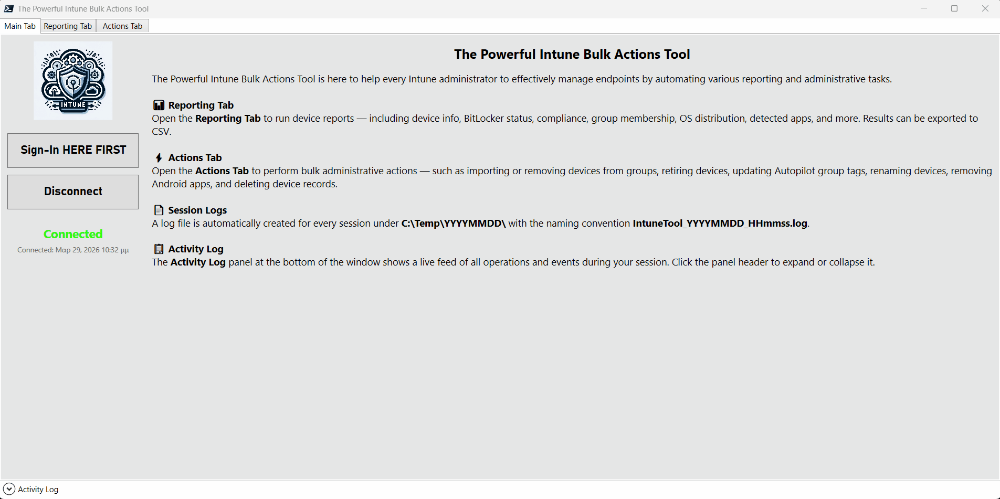

# The Powerful Intune Bulk Actions Tool

A sophisticated, graphical PowerShell/WPF application designed for Microsoft Intune administrators to effortlessly perform bulk device management tasks, reporting, and complex administrative actions.

## 🚀 Features

**🎯 Core Logic:**
At the heart of the tool is ultimate flexibility. For most reporting and action functions, you can choose to target a **Single Device** or run tasks against **Multiple Devices in Bulk** (by providing a simple text file `.txt` list of specific identifiers like Intune Device IDs, Serial Numbers, Entra IDs, or Device Names).

**📊 Extensive Reporting:**
* Retrieve critical device information, BitLocker status, and last logged-on user.
* Pull Autopilot info, TPM/BIOS hardware details, and Policy Non-Compliance settings.
* Analyze OS distribution and App version distribution.
* Check Group Assignments and Intune Group Member details.
* Extract all detected apps across devices.

**⚡ Powerful Actions:**
* Import or remove devices to/from Entra ID groups in bulk.
* Retire devices securely.
* Update Autopilot Group Tags.
* Bulk rename devices based on serial numbers.
* Remove Android Apps from devices via Intune remote action.
* Delete Intune, Autopilot, and Entra ID device records simultaneously.

## 🛠️ Getting Started

### Prerequisites
* **PowerShell 5.1+** (Fully tested and supported on PowerShell 7, VS Code integrated terminal, and PowerShell ISE).
* **Microsoft Graph PowerShell SDK** — only the required submodules, **not** the full `Microsoft.Graph` meta-module.  
The tool **automatically checks** if the modules are installed when it starts. Any missing ones are installed for you (this takes a couple of minutes on first run, instead of the 10–20 minutes the full SDK would need):
  - **Running as Administrator:** installs for all users (`-Scope AllUsers`).
  - **Running without Administrator privileges:** installs for the current user only (`-Scope CurrentUser`) — **no admin rights required**.

  If you prefer to install them manually beforehand:
  ```powershell
  # Add -Scope CurrentUser to install without Administrator privileges
  Install-Module -Name Microsoft.Graph.Authentication, Microsoft.Graph.DeviceManagement, Microsoft.Graph.DeviceManagement.Enrollment, Microsoft.Graph.Devices.CorporateManagement, Microsoft.Graph.Groups, Microsoft.Graph.Users, Microsoft.Graph.Identity.DirectoryManagement -Force -AllowClobber
  ```

  > Already have the full `Microsoft.Graph` meta-module installed? That works too — no reinstall needed.

*(Don't worry about scopes, the tool handles authentication and automatically prompts you for the required Microsoft Graph permissions upon sign-in).*

> 📝 **Note on Permissions:** If you prefer to run the script using your strictly existing Graph permissions without being prompted to consent to new scopes, you can modify `graphFunctions.psm1` (around line 35) in the `Connect-ToMGGraph` function:
> 
> Change:
> `Connect-MgGraph -Scopes $script:RequiredGraphScopes`
> 
> To:
> `Connect-MgGraph # -Scopes $script:RequiredGraphScopes`

### How to Run

**Option 1 — VS Code (easiest):**
1. Open the project folder in VS Code — `File → Open Folder`.
2. Open `script.ps1`.
3. Click the **Run** button (▶) or press `F5`.

VS Code's PowerShell extension launches the script with the correct threading mode automatically — no extra flags needed.

**Option 2 — Standalone PowerShell terminal:**
```powershell
.\script.ps1
```

The UI is built on WPF, which requires **Single-Threaded Apartment (STA)** mode — but you don't need to worry about it: if the script detects it is running in MTA mode (the default for a plain Windows PowerShell console), it **automatically relaunches itself with `-STA`** in the same console. PowerShell 7 and the ISE are STA by default.

## ⚙️ Configuration (optional)

By default, session logs and CSV exports are written to `C:\Temp\YYYYMMDD\`. If that location cannot be created or written to (e.g. on a locked-down machine), the tool automatically falls back to `%TEMP%\IntuneTool\YYYYMMDD\`.

To use a custom location instead, create a `config.json` file next to `script.ps1`:
```json
{
  "ExportDirectory": "D:\\IntuneToolLogs"
}
```

## ⚠️ Note on Graph API Endpoints

Several features (Autopilot device identities, non-compliance reports, detected apps, group membership lookups, and more) rely on the **`beta`** Microsoft Graph endpoint (`https://graph.microsoft.com/beta/...`), because the required functionality is not available in `v1.0`. Microsoft can change beta endpoints without notice — if a specific report or action suddenly stops working after having worked before, this is the most likely cause. Please open an Issue if you hit one.

## 📸 GIF  



## 📚 Technical Documentation

For a deep dive into the code architecture, data flow patterns, function references, and advanced application configuration, please refer to the extensive [Complete Code Documentation](code%20documentation.md) file included in this repository.

## 🤝 Contributing & Feedback

This tool is built to save hours of administrative overhead. If you've encountered an issue, found a bug, or have a brilliant idea to improve it:

* Please **open an Issue** to register any findings, bugs, or feature requests.
* Submit a **Pull Request** if you have improvements or extra functionality to share!

Every bit of feedback helps make this tool better for the Intune community. Happy managing!
